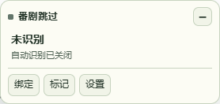
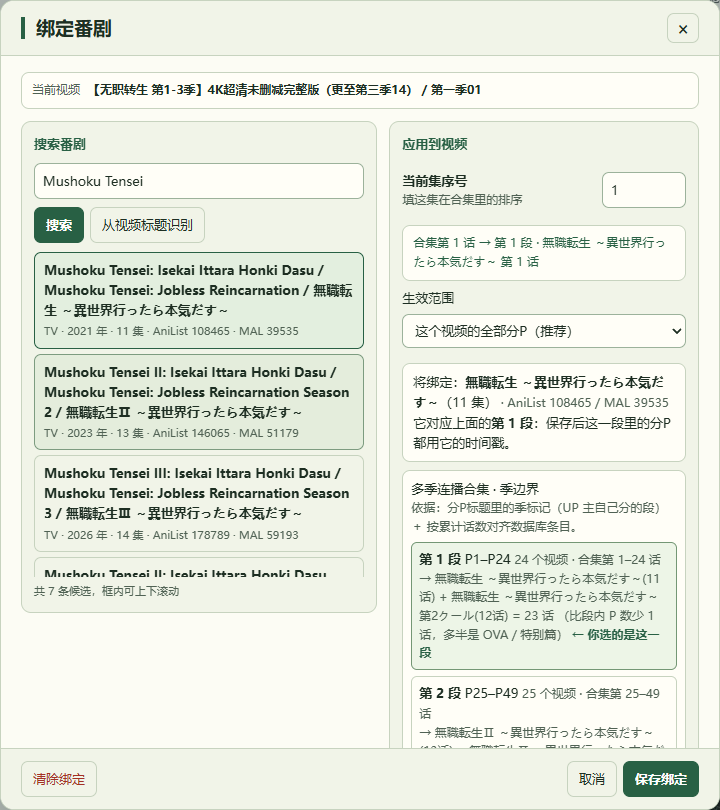
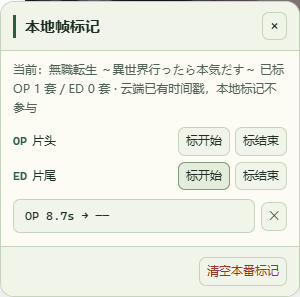
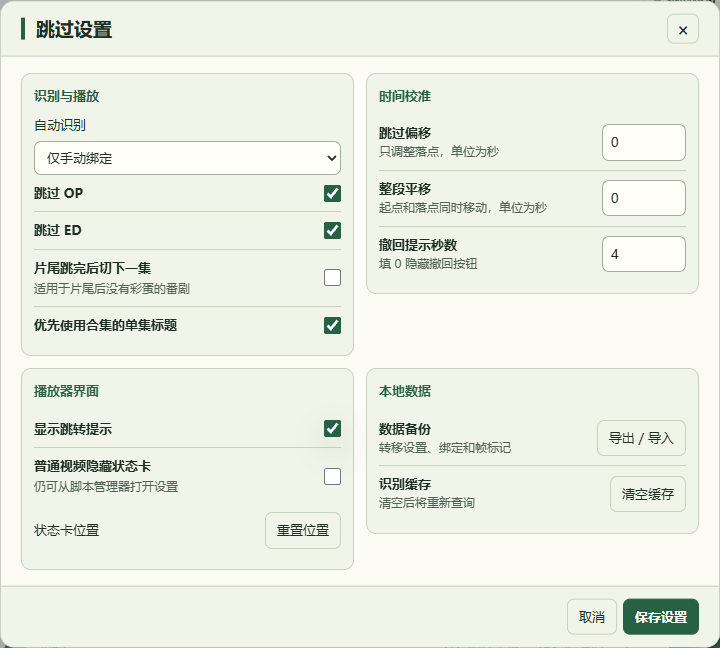

# Bilibili 番剧 OP/ED 跳过

[](https://greasyfork.org/zh-CN/scripts/600364)
[](https://github.com/PZero534232/bilibili-aniskip/actions/workflows/test.yml)
[](LICENSE)

给 B 站网页端的用户投稿番剧补上跳过片头和片尾的功能。脚本从 AniSkip 和 Anime Skip 取得时间戳，支持手动绑定、多季合集，以及在没有时间戳时用本地画面指纹识别 OP/ED。

[安装](#安装) · [快速上手](#快速上手) · [手动绑定](#手动绑定) · [本地帧标记](#本地帧标记) · [设置](#设置) · [常见问题](#常见问题)

## 安装

1. 在桌面浏览器安装 [Tampermonkey（篡改猴）](https://www.tampermonkey.net/) 或 [Violentmonkey（暴力猴）](https://violentmonkey.github.io/)。
2. 打开 [Greasy Fork 安装页](https://greasyfork.org/zh-CN/scripts/600364)，点「安装此脚本」。也可以从 [GitHub](https://raw.githubusercontent.com/PZero534232/bilibili-aniskip/main/bilibili-aniskip.user.js) 或 [jsDelivr](https://cdn.jsdelivr.net/gh/PZero534232/bilibili-aniskip@main/bilibili-aniskip.user.js) 安装同一份脚本。
3. 打开 B 站的用户投稿视频页（`bilibili.com/video/…`）。页面右上角会出现「番剧跳过」状态卡。

Chrome 或 Edge 如果提示缺少用户脚本权限，请按脚本管理器的说明启用。Tampermonkey 的具体步骤见[用户脚本权限说明](https://www.tampermonkey.net/faq.php?q=Q209)。

## 快速上手



默认模式是「仅手动绑定」。想让某部番自动跳过，点状态卡上的「绑定」，选好番剧和集数后保存。想让脚本根据视频标题自行识别，打开「设置」切换模式。

| 自动识别模式 | 行为 |
| --- | --- |
| 仅手动绑定（`off`，默认） | 自动跳过已手动绑定的番剧。未绑定的视频只读取 B 站视频信息。 |
| 识别后手动跳过（`ask`） | 识别后显示「跳过」，点了才跳。 |
| 高置信度时自动跳过（`auto`） | 置信度 ≥ 60 时自动跳过。分数较低时仍可手动点「跳过」。 |

识别后，点状态卡上的番名可查看本集各段的起止时间和来源。整段落在视频前半段的 ED 会显示「核对」，接近该片段时可以手动确认。跳过后默认有 4 秒可撤回。

状态卡支持拖动和收起，位置可以在设置里重置。B 站网页全屏时会隐藏状态卡，退出全屏后恢复。

## 手动绑定

标题缺少番名、匹配到了别季，或一个视频包含多季时，可以手动指定番剧。

1. 点「绑定」。已有绑定时，点「改绑定」。
2. 搜索番名，或点「从视频标题识别」。支持中文、日文、罗马字和英文。可用简写，例如 `Re:0`。
3. 选中正确的条目。「将绑定」会显示选中的番剧，多季合集会展示季边界。
4. 「当前集序号」填这集在合集里的排序。例如当前看的是第 21 个分 P，就填 21。面板会显示对应的季和话数。
5. 选择生效范围，点「保存绑定」。多个范围同时有绑定时，**单 P 优先，其次是这个视频的全部分 P，最后是整个合集**。

多季合集在推算季边界时会暂时禁用保存。检测到季号冲突、分段没对齐或该分 P 超出对应条目的话数时，状态卡会提示原因。OP/ED 的时间戳按识别出的季和集查询。

<details>
<summary>查看绑定面板</summary>



</details>

## 本地帧标记

当云端没有返回本集片段，或时间戳服务不可用时，已绑定的番剧可以用本地画面指纹兜底。

1. 先绑定番剧，再点状态卡上的「标记」。
2. 播到 OP 或 ED 的开头，在对应行点「标开始」。到片段结束时点「标结束」。
3. 标记会在绑定范围内复用。点击已有标记可以跳到记录位置，点行尾的「×」可以删除该条。

OP 需要同时标开始和结束。ED 如果只标开始，命中时会跳到视频末尾。如果后面有彩蛋，请标出片尾实际结束的位置。标在清晰、相对静止的标题卡上通常更容易跨集识别。

工具条会显示本集正在使用云端时间戳，还是正在匹配本地指纹。拖动工具条标题可以移位，再点「标记」或点关闭按钮可退出。

<details>
<summary>查看本地标记工具条</summary>



</details>

## 设置

通过状态卡的「设置」或脚本管理器菜单的「番剧跳过设置」打开。

| 设置 | 默认 | 说明 |
| --- | --- | --- |
| 自动识别 | 仅手动绑定 | 可切换为识别后手动跳过或高置信度时自动跳过。 |
| 跳过 OP / 跳过 ED | 都开启 | 独立控制片头和片尾。 |
| 片尾跳完后切下一集 | 关闭 | 有撤回提示时会等撤回窗口结束。点「撤回」会返回原位并取消切集。 |
| 优先使用合集的单集标题 | 开启 | 如果 UP 主改过合集内的标题，优先用它识别。 |
| 跳过偏移 | `0` 秒 | 只移动落点。正数多跳，负数少跳，范围 ±30 秒。 |
| 整段平移 | `0` 秒 | 同时移动起点和落点。开头多了一段 20 秒内容，可以填 20。 |
| 撤回提示秒数 | `4` | 填 0 会关闭撤回按钮。 |
| 显示跳转提示 | 开启 | 显示跳过结果和撤回按钮。 |
| 普通视频隐藏状态卡 | 关闭 | 仅手动绑定模式下，隐藏未绑定视频的状态卡。仍可从脚本管理器打开设置。 |
| 重置位置 | — | 把状态卡移回右上角。 |
| 数据备份 | — | 导出或导入设置、绑定和帧标记。导入会替换当前数据，可撤销一次。 |
| 清空缓存 | — | 删除查询缓存，下次识别会重新请求。 |

<details>
<summary>查看设置面板</summary>



</details>

## 常见问题

### 状态卡没有出现

检查脚本管理器是否已启用脚本，当前地址是否为 `/video/…`。如果曾隐藏普通视频上的状态卡，可以从脚本管理器菜单打开设置。

### 中文搜不到，或者认错季

用「绑定」搜索日文原名或罗马字。合集有预告、OVA 或特别篇时，先核对面板显示的季边界。只需要纠正一集时可选择「只在这一 P 生效」。

### 识别了番剧却没有跳过

先点番名检查本集是否有时间戳和是否启用了对应的 OP/ED。显示「核对」时，需要手动确认可疑片段。遇到「数据源限流」或「网络不通」，可以稍后重试。

### 本地标记没有生效

确认当前视频命中了保存标记的绑定，并查看工具条状态。云端已有片段时优先使用云端。同一画面被大幅裁剪、覆盖字幕或换成另一版 OP 时，画面指纹可能无法匹配。

## 数据与开发

- [AniSkip](https://aniskip.com/) 和 [Anime Skip](https://anime-skip.com/) 提供时间戳。[AniList](https://anilist.co/) 提供番剧条目和续季关系，[Bangumi](https://bgm.tv/) 辅助中文番名匹配。B 站 `view` 接口提供视频标题、分 P 和合集信息。
- 识别过程中，对应服务会收到番名查询或用于查找条目的 ID。设置、绑定、帧标记和缓存保存在脚本管理器中。脚本没有自建服务器或遥测。
- `bilibili-aniskip.user.js` 是可直接安装的单文件脚本，无构建步骤。Node.js 18 及以上可运行仓库自带的零依赖检查。

```sh
npm test
node --check bilibili-aniskip.user.js
```

反馈问题时，可附上 BV 号、分 P、识别模式和状态卡显示的内容。 [提交问题](https://github.com/PZero534232/bilibili-aniskip/issues)

[更新日志](CHANGELOG.md) · [MIT 许可](LICENSE)
