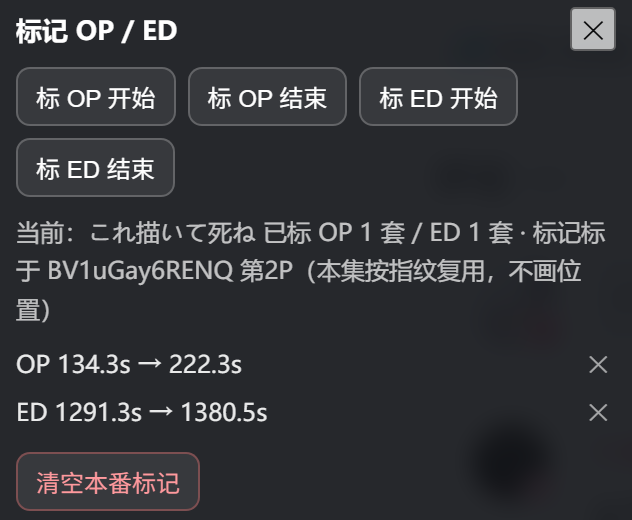

<div align="center">

<h1>Bilibili 番剧 OP/ED 跳过</h1>

<a href="https://greasyfork.org/zh-CN/scripts/600364"></a>
<a href="https://greasyfork.org/zh-CN/scripts/600364"></a>
<a href="https://greasyfork.org/zh-CN/scripts/600364"></a>

<br>
<br>

[安装](#安装) / [功能](#功能自动跳-oped手动绑定本地标记) / [使用](#使用) / [兼容性](#脚本管理器与浏览器) / [常见问题](#常见问题) / [开发](#开发)

<br>
<br>

</div>

用外部动画时间戳库（AniSkip / Anime Skip）给 B 站番剧自动跳过 OP/ED —— 包括 B 站官方没有时间戳的「用户上传」搬运番。番名支持中文 / 罗马字 / 日文 / 英文 / 简写搜索，多季连播合集按分P分段自动对齐数据库条目；标题乱码、没有番名时可以手动绑定整季一次、全季复用。默认不自动识别，普通视频零请求、绝不触发。

## 功能：自动跳 OP/ED、手动绑定、本地标记

- **自动跳过 OP / ED**：两个独立开关
- **怎么搜都能中**：中文名、罗马字、日文原名、英文名、简写（`Re:0`）都行 —— 中文名走 Bangumi 桥换成日文原名，再拿去 AniList 查
- **多季连播合集**：一个视频塞 60 个分P、横跨 5 季，按分P标题里的季号／话数自动对齐数据库条目，一段可以包含多个季度
- **手动绑定**：标题乱码、没有番名、自动认错季时，搜一次绑一次，按「整个合集 / 这个视频的全部分P / 单 P」三档作用域复用
- **本地手动标记（冷番兜底）**：数据库里没有的番，点胶囊上的 🎯 边看边标 OP/ED 的起止帧，脚本认画面指纹自动跳，同番每集复用
- **状态胶囊**：播放器上常驻显示识别状态；可用鼠标／手指拖到任意位置、可收成一颗圆点，网页全屏时自动隐藏
- **跳错能撤回**：每次跳过后有 4 秒的「撤回」窗口，点了回到原来的位置
- **偏移与平移**：搬运版剪过／加过片头时，用「跳过偏移」和「整段平移」把时间戳对齐回来
- **自动切下一集**：ED 跳完直接切下一个 P／下一话（设置开关，默认关）

## 安装

### 前提：允许运行用户脚本

Firefox 无需操作，Edge / Chrome 操作如下：

1. 右键单击脚本管理器（篡改猴 / 暴力猴）
2. 点击「管理扩展程序」
3. 若出现「允许用户脚本」选项，启用它
4. 启用「开发者模式」
5. 重启浏览器

### 安装脚本

- [Greasy Fork](https://greasyfork.org/zh-CN/scripts/600364)（推荐）
- [GitHub raw](https://raw.githubusercontent.com/PZero534232/bilibili-aniskip/main/bilibili-aniskip.user.js)
- [jsDelivr](https://cdn.jsdelivr.net/gh/PZero534232/bilibili-aniskip@main/bilibili-aniskip.user.js)（GitHub 连不上时用）

## 使用

> [!IMPORTANT]
> - **默认「不自动识别」**：普通视频零请求、零干扰。想看效果有两种方式 —— 胶囊上点「绑定」手动指定这部番；或点 ⚙ 把「自动识别」改成 `ask` / `auto`。
> - **自动识别三档**：`off`（默认，只认手动绑定的番）／`ask`（识别后胶囊上出现「跳过」按钮，点了才跳）／`auto`（置信度 ≥ 60 才自动跳，没过门槛退化成 ask）。

点胶囊上的按钮：**绑定**（手动指定番剧）、**🎯**（本地手动标记）、**⚙**（设置）、**–**（收成圆点，点圆点展开）。胶囊可以用鼠标／手指拖到任意位置，位置会记住（设置里「重置位置」可复原）；检测到 B 站「网页全屏」时胶囊整体隐藏，退出全屏自动恢复。


碰到一部番，按下面的顺序走：

| 胶囊显示                      | 做法                                                             |
| ----------------------------- | ---------------------------------------------------------------- |
| 番名 + 段数（如 `芙莉莲 第3集 12 段`） | 什么都不用做：`auto` 会自己跳；`ask` 点胶囊上的「跳过」          |
| `未识别` / `没匹配到番剧`     | 展开下面「手动绑定番剧」，搜一次绑一次                            |
| 绑好了还是不跳                 | 展开下面「本地手动标记」，标一次 OP/ED                            |

标题乱码、没有番名、认错番、或者要指定具体是哪一季时用：


<details>
<summary><b>手动绑定番剧</b></summary>

<br>

1. 点胶囊上的「绑定」
2. 在搜索框里输番名（中文 / 罗马字 / 日文 / 英文 / 简写都行），点「搜索」；或点「用标题自动填」
3. 从候选里选中正确的番剧 —— 「将绑定」那一行会写清你选的是哪一条；多季连播合集还会标出**你选的这条落在第几段**
4. 填「当前是第几话」：填**这一集在这个合集里的序号**（合集共 32 个视频、你在看第 21 个，就填 21，脚本会自己算出它是第几季第几话）
5. 选「生效范围」：默认是最宽的一档 —— 有 UGC 合集时是「整个合集（含合集里其他视频）」，否则是「这个视频的全部分P（推荐）」；也可以限成「只在这一 P 生效」
6. 保存

> [!NOTE]
> - 多季连播合集在**季边界算出来之前「保存」是灰的**（面板上写「正在推算季边界…」）：存成没有季链的单季绑定会让整个合集用错季的时间戳，宁可等这一两秒
> - 候选列表里会出现**整个系列**的条目（第2クール、第二季、第三季…）：中文名在 AniList 上常常搜不全（实测「无职转生」只回 3 条、没有第三季），补进来的条目下面写明「共 N 条候选」，框子能上下滚
> - ≤0.4.5 存下的、**没有季链的绑定**会自动补算季链并写回；补算完成前这一话明显不属于你绑的那一季时，脚本**宁可先不跳**（胶囊上写「绑定的季和这一话对不上」），也不会拿错季的时间戳去跳
> - 中文名搜不到时换成**日文原名或罗马字**再搜（中文名要先经 Bangumi 桥换成日文原名才能查 AniList）

</details>

数据库里没有的番（太新、太冷门、OVA），手动标一次。入口是胶囊上的 **🎯**：工具条浮在播放器左下角，非模态、不挡画面，可以拖到任意位置，位置会记住；再点一次 🎯、或点工具条右上角的 **✕** 退出。标记模式是持久化状态，刷新页面后工具条会自己回来。



<details>
<summary><b>本地手动标记（冷番兜底）</b></summary>

<br>

1. 播到 OP 开头 → 点「**标 OP 开始**」；播到 OP 结束 → 点「**标 OP 结束**」（ED 同理：标 ED 开始 / 标 ED 结束）
2. 标完立刻生效，不用刷新页面
3. 已标条目列在工具条里：**点正文**跳到那个时间点，**点 ✕** 删掉这一条，**清空本番标记**全部清掉

判定方式：每 250ms 抓一帧 → 缩到 160×90 灰度 → 8×8 平均哈希（64 位）→ 和你标的那一帧比汉明距离（≤ 10/64 算命中）→ **连续 2 帧命中**才算认到 → 跳到「认到的那一刻 + 你标的时长」。落点用的是**时长**而不是绝对秒数，所以同番换集、OP 位置不同也能对上；同一指纹**一集只跳一次**，跳完还有 3 秒静默期。

> [!WARNING]
> **标了却没跳，按顺序查：**
> - **当前视频绑定这部番了吗** —— 标记是按番剧绑定存的，没绑定时点标记按钮会提示「先绑定 / 识别这个番剧再标」
> - **云端是不是已经有这一集的时间戳** —— 有就一切以云端为准，本地指纹只在云端没给段、或网络失败时兜底
> - **OP 是不是没标「结束」** —— 只标了开始的 OP 视为没标完，**整条不参与匹配**（ED 可以不标结束，那就跳视频末尾）
> - **有没有播到那一帧** —— 暂停时不抽帧，得播过去；画面被重裁、贴了大面积字幕、或你标的是快速运动的画面，指纹可能认不出

> [!TIP]
> 标在 OP 里**相对静止、有标志性**的一帧（开场定帧、标题卡那种）最稳。标记挂在番剧绑定上，所以同番每集自动复用；每条标记还会记下「标在哪一集」，换集后工具条状态行会写明「标记标于 BV… 第2P（本集按指纹复用）」。进度条上不画任何标记。

</details>

面板长这样（点胶囊上的 **⚙**，或油猴菜单里的「番剧跳过设置」）：


<details>
<summary><b>设置项</b></summary>

<br>

| 设置项                    | 默认      | 说明                                                                                                                            |
| ------------------------- | --------- | ------------------------------------------------------------------------------------------------------------------------------- |
| 自动识别                  | `off`     | 见上文三档                                                                                                                      |
| 跳过 OP / 跳过 ED         | 开        |                                                                                                                                 |
| 跳过偏移（秒）            | `0`       | 在数据库给的时间戳上再挪一点。正数＝多跳（跳过 OP 后的黑屏／静帧），负数＝少跳（留住 OP 尾巴），最多减到片段起点。范围 ±30      |
| 片头/片尾整段平移（秒）   | `0`       | UP 主在开头多加了片段时用：OP/ED 的**起点和落点一起**挪，比如开头多加了 20 秒就填 20。范围 ±30                                  |
| 撤回提示秒数              | `4`       | 跳过后「撤回」按钮停留多久，0 = 不显示                                                                                          |
| 显示跳转提示              | 开        | 跳转时弹提示                                                                                                                    |
| 优先用合集单集标题        | 开        | UP 主在合集里改过的标题往往比原始标题干净                                                                                        |
| 隐藏胶囊（普通视频）      | 关        | 勾上后未识别出番剧的普通视频上不显示胶囊（连收起成的小圆点也一起藏），识别成功／已绑定的番剧照常显示。想找回入口用油猴菜单       |
| 自动切下一集              | **关**    | ED 跳完直接切下一个 P／下一话（依次退化：播放器的下一集按钮 → 同 BV 分P → UGC 合集下一话）；只给「ED 后面没有彩蛋」的番用        |
| 胶囊位置                  | ——        | 拖动后位置自动记住；点「重置位置」回到右上角                                                                                    |
| 清空缓存                  | ——        | 清掉识别结果与时间戳缓存，下次识别重新联网查                                                                                    |

油猴菜单里另有两个入口（和胶囊按钮等价）：🔍 绑定 / 识别番剧、⚙ 番剧跳过设置。

</details>

## 脚本管理器与浏览器

| 脚本管理器                                                 | 是否支持 | 备注           |
| ---------------------------------------------------------- | -------- | -------------- |
| [Tampermonkey (篡改猴)](https://www.tampermonkey.net/)     | ✔️       | 完全测试，推荐 |
| [Violentmonkey (暴力猴)](https://violentmonkey.github.io/) | ✔️       | 可用           |
| Greasemonkey                                               | ❌️       | 未测试         |

- Chrome / Edge 138 起需要在扩展详情里打开「允许用户脚本」，否则脚本装了也不会运行（见[安装](#安装)）
- 专注 PC 网页端，不做移动端适配；B 站「网页全屏」时胶囊隐藏，「真实全屏」本来就不显示胶囊

## 常见问题

<details>
<summary><b>展开查看</b></summary>

<br>

**Q：会误跳正片吗？**
默认 `off` 完全不自动识别；`auto` 模式要过置信度门槛（60 分）才跳；每次跳过后 4 秒内可以点「撤回」回到原位。

**Q：打开了却什么都不跳？**
看胶囊上的提示：`未识别` = 标题没认出番剧，用「绑定」；`没找到集号` = 标题里没有集数，绑定面板里手动填；`没匹配到番剧` = 名字抽出来了但库里没有，换个关键词绑定；`数据源限流(429)` / `请求超时` / `网络不通` = 接口挂了或被限流，过一会儿重试（这类失败不会写进缓存）。这一集数据库里就是没有时间戳的话，用本地手动标记。

**Q：搜索搜不到我的番？**
换成**日文原名或罗马字**再搜一次（比如「葬送的芙莉莲」搜不到就搜「葬送のフリーレン」或 `Frieren`）—— 中文名要先经 Bangumi 桥换成日文原名才能拿去查 AniList，桥没命中时中文名就会搜不到。

**Q：换集后标记还在，要重标吗？**
不用。标记跨集复用是设计（标一次整季有效），跳过只用标记的「时长」，跟哪一集无关。工具条状态行会写明这条标记标于哪一集。

**Q：换视频 / 切分P 之后要重新弄吗？**
不用。B 站是单页应用，脚本会检测地址和分P变化自动重新识别，绑定过的番剧整个合集都覆盖。

**Q：想排查「为什么没跳 / 为什么搜不到」？**
控制台里有调试对象 `__biliAniskip`：

```js
__biliAniskip.api_.searchByName('葬送のフリーレン')
  .then(r => console.log('结果条数', r.length, '失败记录', __biliAniskip._runtime.netFail));
```

</details>

## 开发

<details>
<summary><b>展开查看</b></summary>

<br>

单文件 `bilibili-aniskip.user.js`，**没有构建步骤** —— 改完直接装进脚本管理器就能跑。

- **ES5 约束**：脚本直接跑在被改写的页面上，全文只用 `var` / `function` / 字符串拼接，不用 `let` / `const` / 箭头函数 / 模板字符串。测试文件不受此限。
- **测试**：`test/bilibili-aniskip.test.js` 是零依赖自建测试（DOM / GM 存储 / GM_xmlhttpRequest / window 事件全是手写桩），覆盖标题清洗、集号抽取、时长打分、区间校验、双源合并、多分P锚点推算、多季对齐、自动识别三档语义与置信度门槛、网络失败与缓存策略、手动绑定优先级、季链与错季闸门、本地指纹存取与匹配、标记集号。

```bash
node test/bilibili-aniskip.test.js        # 全量（当前 699 条断言，以实际输出为准）
node test/bilibili-aniskip.test.js -q     # 只打失败与汇总
node --check bilibili-aniskip.user.js     # 语法检查
```

- **实现说明**：UI（胶囊 / 面板 / 提示 / 工具条）走 Shadow DOM，不与 B 站自己的 CSS 打架；面板里的文本输入控件放在 light DOM 用 `<slot>` 投影进影子树（Shadow DOM 会把事件 `target` 重定向成影子宿主，B 站「正在输入就不响应快捷键」的判断会失效，表现为搜索框里打 `q` 触发点赞），面板打开期间在 `window` 捕获阶段兜底拦截按键；关键样式全部内联，页面 CSP 拦掉样式注入时界面至少还能显示和点击。

</details>

## 数据源与隐私

- 时间戳：[AniSkip](https://aniskip.com/)（主键 MAL ID）、[Anime Skip](https://anime-skip.com/)（主键 AniList ID）
- 检索：[AniList](https://anilist.co/) GraphQL（番名检索、ID、续集关系）、[Bangumi](https://bgm.tv/)（中文名 → 日文原名的桥）、[B 站 view 接口](https://api.bilibili.com/)（标题 / 分P / UGC 合集，只读）
- 只用公开只读 API，不带账号信息，不收集、不上传任何数据；设置、绑定、本地标记、缓存全部只存在本地（`GM_setValue`）

## 许可

[MIT](./LICENSE)。更新日志见 [CHANGELOG.md](./CHANGELOG.md)。
